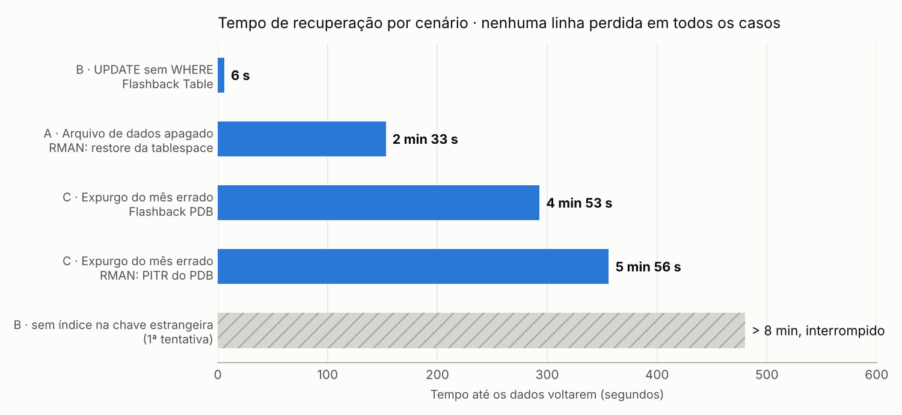
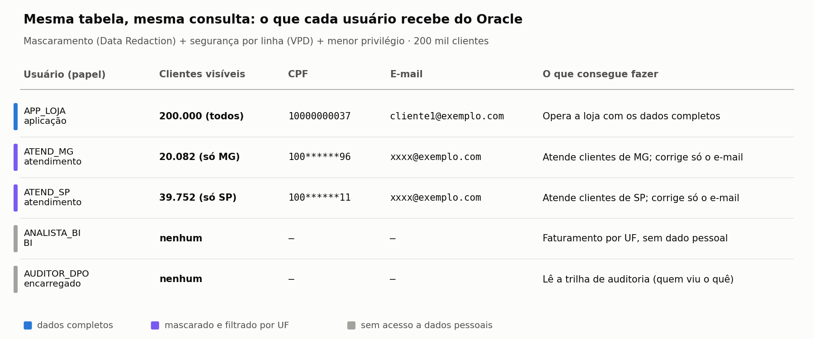

# Laboratório de DBA Oracle

> Atividades clássicas de um DBA Oracle feitas de ponta a ponta num ambiente que imita um servidor real: **Oracle AI Database 26ai Free** instalado por RPM num **Oracle Linux 10** (máquina virtual). Cada módulo traz os scripts, as evidências (logs) e o resultado medido.

> ⚠️ **Laboratório, não execute em produção.** Os scripts foram escritos para este ambiente (usuário `LAB`, PDB `FREEPDB1`, tabelas e caminhos da VM) e vários são destrutivos de propósito: apagam arquivos de dados, fazem `DELETE` em massa, voltam o banco no tempo, criam e apagam usuários e reiniciam a instância. Use-os como referência e adapte em um ambiente de testes. O trecho mais reaproveitável é a rotina [`backup_rman.sh`](modulo-2-backup/backup_rman.sh); as políticas do módulo 3 servem de modelo trocando os nomes de tabelas e colunas.

| Módulo | Tema | Situação |
|---|---|---|
| [1. Tuning de desempenho](#módulo-1-tuning-de-desempenho) | Planos de execução, índices, reescrita de SQL e particionamento online | ✅ Concluído |
| [2. Backup e recuperação](#módulo-2-backup-e-recuperação) | ARCHIVELOG, RMAN, Flashback e três desastres simulados com tempo de recuperação medido | ✅ Concluído |
| [3. Segurança e LGPD](#módulo-3-segurança-e-lgpd) | Inventário de dados pessoais, menor privilégio, mascaramento, segurança por linha, auditoria e direito à eliminação | ✅ Concluído |
| 4. Migração para a nuvem | Migração para o Oracle Autonomous Database (OCI) | Em breve |

---

## Ambiente

| Item | Configuração |
|---|---|
| Virtualização | VirtualBox no Windows; VM com 4 vCPUs, 6 GB de RAM e disco de 80 GB |
| Sistema operacional | Oracle Linux 10.2 (instalação "Server", sem interface gráfica) |
| Banco | Oracle AI Database 26ai Free 23.26.3, multitenant: CDB `FREE` e PDB `FREEPDB1` |
| Acesso | SSH (porta 2222) e listener (porta 1521) redirecionados do Windows para a VM |

**Instalação, como num servidor real:**

```bash
# pré-requisitos oficiais (usuário oracle, grupos, parâmetros de kernel, limites, pacotes)
dnf -y install oracle-ai-database-preinstall-26ai
# software do banco
dnf -y localinstall oracle-ai-database-free-26ai-23.26.3-1.el10.x86_64.rpm
# criação do banco (CDB + PDB) e do listener
/etc/init.d/oracle-free-26ai configure
# porta do listener e inicialização automática com o sistema
firewall-cmd --permanent --add-port=1521/tcp && firewall-cmd --reload
systemctl enable oracle-free-26ai
```

Antes dos módulos, os recursos disponíveis na edição Free foram conferidos em `V$OPTION`: Partitioning, Advanced Compression, Flashback Database, Fine-grained access control, Data Redaction e Unified Auditing estão ativos.

Um snapshot da VM com o banco recém-instalado permite voltar ao ponto inicial em segundos.

---

## Módulo 1: tuning de desempenho

**Cenário:** banco de um e-commerce com **200 mil clientes, 5 milhões de pedidos e 10 milhões de itens** (~800 MB), criado de propósito só com as chaves primárias e o índice único do CPF. Cinco consultas lentas típicas de produção foram diagnosticadas pelo plano de execução e corrigidas.


| # | Problema | Diagnóstico (plano de execução) | Correção | Blocos lidos (antes → depois) | Tempo (antes → depois) |
|---|---|---|---|---|---|
| 1 | Itens de um pedido | Chave estrangeira `itens_pedido.pedido_id` **sem índice**: leitura da tabela inteira (10 milhões de linhas) | Índice na chave estrangeira | 39.571 → **8** | 0,42 s → 0,01 s |
| 2 | Últimos 20 pedidos de um cliente | Leitura da tabela inteira + ordenação | Índice composto `(cliente_id, data_pedido)`: filtro e ordenação saem prontos do índice | 42.939 → **25** | 0,22 s → < 0,01 s |
| 3 | Pedidos de um dia | `TRUNC(data_pedido)` aplicado na coluna impede o uso de índice | Reescrever como intervalo de datas + índice local por data | 42.939 → **884** | 1,95 s → 0,02 s |
| 4 | Busca por CPF | CPF (texto) comparado com **número**: o Oracle converte a coluna (`TO_NUMBER`) e ignora o índice que já existia | Comparar com texto (correção na aplicação, sem criar nada) | 2.038 → **4** | 0,06 s → < 0,01 s |
| 5 | Relatório de um mês | Leitura dos 34 meses para usar 1 | **Particionamento online** por mês (`INTERVAL`): só a partição do mês é lida (*partition pruning*) | 42.939 → **853** | 0,31 s → 0,05 s |

*Medido com `SET AUTOTRACE TRACEONLY STATISTICS` e `SET TIMING ON`, na segunda execução de cada consulta. "Blocos lidos" são os consistent gets: a métrica principal, porque não depende do cache nem da máquina.*

**Destaques:**

- O particionamento foi feito com `ALTER TABLE ... MODIFY PARTITION BY RANGE ... ONLINE UPDATE INDEXES`: a tabela de 5 milhões de linhas virou 34 partições mensais **sem ficar indisponível** (1 min 13 s) e, com `INTERVAL`, cada novo mês ganha sua partição automaticamente.
- Os tempos absolutos são pequenos porque o banco inteiro cabe na memória da VM. Em produção, com centenas de sessões concorrentes e dados maiores que a memória, a redução de **50 a 5.000 vezes** nas leituras é o que evita filas de CPU e disco.
- Antes das correções, as consultas que varriam `PEDIDOS` faziam ~29 mil leituras físicas em toda execução: tabelas grandes lidas por inteiro usam *direct path read* e não ficam no cache.
- O cenário 1 também resolve um problema de concorrência: sem índice na chave estrangeira, apagar ou alterar um pedido trava a tabela de itens inteira.

**Como reproduzir** (dentro de `modulo-1-tuning`, na VM):

```bash
sqlplus / as sysdba @00_criar_usuario.sql                                # tablespace e usuário LAB
sqlplus lab/<senha>@//localhost:1521/FREEPDB1 @01_carga_dados.sql        # 15 milhões de linhas
sqlplus lab/<senha>@//localhost:1521/FREEPDB1 @02_consultas_antes.sql    # logs/antes.log
sqlplus lab/<senha>@//localhost:1521/FREEPDB1 @03_otimizacoes.sql        # logs/otimizacoes.log
sqlplus lab/<senha>@//localhost:1521/FREEPDB1 @04_consultas_depois.sql   # logs/depois.log
```

Os planos de execução completos de antes e depois estão em [`modulo-1-tuning/logs`](modulo-1-tuning/logs).

---

## Módulo 2: backup e recuperação

**Cenário:** o mesmo banco do módulo 1 (5 milhões de pedidos e 10 milhões de itens, cerca de 5 GB no PDB) recebe uma estratégia de backup de produção, que depois é posta à prova em **três desastres simulados**: um arquivo de dados apagado do disco, um `UPDATE` sem `WHERE` e uma rotina de expurgo que apaga o mês errado em duas tabelas.



| Cenário | O que aconteceu | Solução | Indisponibilidade | Dados perdidos |
|---|---|---|---|---|
| **A** | O arquivo `lab_dados01.dbf` (1,7 GB) some do disco; a aplicação recebe `ORA-01116` | Só a tablespace afetada fica offline → RMAN `RESTORE` (nível 0) + `RECOVER` (nível 1 + archivelogs) → online | **2 min 33 s**, só para as tabelas da aplicação; o resto do PDB continuou no ar | Nenhum |
| **B** | Uma promoção para um produto é aplicada ao catálogo inteiro: 5 mil preços viram R$ 9,90, com `COMMIT` | Diagnóstico com Flashback Version Query (o que mudou e quando) + `FLASHBACK TABLE` | **6 s**, sem parar nada e sem tocar em backup | Nenhum |
| **C** | O expurgo de dados antigos roda com a data errada e apaga out/2025: 148.921 pedidos e 298.496 itens, com `COMMIT` | **1)** RMAN: PDB volta até o SCN do ponto de restauração (PITR) | **5 min 56 s** com o PDB fechado | Nenhum |
| | O mesmo erro, repetido | **2)** `FLASHBACK PLUGGABLE DATABASE` até o ponto de restauração | **4 min 53 s** com o PDB fechado | Nenhum |

*Em todos os cenários, a contagem de linhas depois da recuperação bateu exatamente com a de antes do problema (5.050.000 pedidos e 10.100.000 itens).*

**Estratégia de backup:**

| Item | Configuração |
|---|---|
| Modo do banco | `ARCHIVELOG` + Flashback Database (retenção de 24 h), na Fast Recovery Area de 25 GB |
| Política do RMAN | Janela de recuperação de 7 dias, autobackup do controlfile e do spfile, compressão BASIC e archivelog apagado só depois de ter backup |
| Agenda (cron) | Domingo: nível 0 · Segunda a sábado: nível 1 · De hora em hora: archivelogs |
| Rotina | [`backup_rman.sh`](modulo-2-backup/backup_rman.sh): crosscheck, backup, limpeza do que ficou obsoleto e registro do resultado |

| Backup | Lido | Gravado | Tempo |
|---|---|---|---|
| Nível 0 (todos os blocos usados) | 5.218 MB | **914 MB** | 4 min 18 s |
| Nível 1, depois de um "dia de operação" (50 mil pedidos, 100 mil itens e 14 mil atualizações) | 4.605 MB | **74 MB** | 1 min 05 s |
| Archivelogs | 18 MB | 1 MB | 15 s |
| Validação: `RESTORE DATABASE VALIDATE CHECK LOGICAL` | todos os backups | nenhum bloco corrompido | 4 min 21 s |

**Destaques:**

- **A lição que não estava no roteiro:** na primeira execução do cenário B, o `FLASHBACK TABLE` passou de **8 minutos sem terminar** e foi interrompido. Ele refaz as linhas de `PRODUTOS`, e a cada linha o Oracle confere a chave estrangeira em `ITENS_PEDIDO`, que não tinha índice em `produto_id`: 5 mil leituras de uma tabela de 10 milhões de linhas. Com o índice (57 s para criar), o mesmo comando levou **6 segundos**. É o mesmo problema do cenário 1 do módulo 1, agora atrasando uma recuperação de desastre ([log da tentativa](modulo-2-backup/logs/06_primeira_tentativa_travou.log)).
- **Recuperar só o que quebrou:** no cenário A, a tablespace danificada foi restaurada com o PDB aberto; consultas a outras partes do banco continuaram funcionando durante todo o processo.
- **Cada ferramenta no seu lugar:** erro numa tabela → Flashback Table (segundos, sem parada); erro espalhado em várias tabelas → Flashback PDB; perda de arquivo ou erro fora da janela de flashback → RMAN.
- **RMAN x Flashback no cenário C:** a diferença foi pequena (5 min 56 s x 4 min 53 s) porque o PDB tem só 5 GB e o disco é local: o RMAN restaurou tudo em 2 min e reaplicou os logs em 12 s; o restante foi fechar e reabrir o PDB depois de um `DELETE` grande. O tempo do RMAN cresce com o **tamanho do banco**; o do Flashback, com o **volume alterado**: num banco de centenas de GB, a vantagem do Flashback cresce muito.
- **Ponto de restauração antes de processos em massa** (`CREATE RESTORE POINT`): é ele que diz "para onde voltar" sem precisar adivinhar horários.
- **Depois de um `OPEN RESETLOGS`, novo backup nível 0** é feito automaticamente pelo script do cenário C.
- **Perda máxima de dados:** nos três cenários foi zero, porque os redo logs online estavam intactos. Se o servidor inteiro fosse perdido, a agenda de archivelogs limita a perda a no máximo 1 hora.

**Como reproduzir** (dentro de `modulo-2-backup`, na VM, como `oracle`):

```bash
./01_ativar_archivelog.sh            # ARCHIVELOG, Flashback e Fast Recovery Area
./02_configurar_rman.sh              # política do RMAN
./backup_rman.sh nivel0              # backup completo
./03_simular_movimento.sh            # um dia de operação
./backup_rman.sh nivel1              # incremental
./backup_rman.sh archivelog
crontab crontab_oracle.txt           # agenda dos backups
./04_validar_backups.sh              # os backups restauram?
./05_cenario_a_perda_datafile.sh     # cenário A
./06_cenario_b_update_sem_where.sh   # cenário B
./07_cenario_c_pitr_rman.sh          # cenário C com RMAN (+ novo nível 0)
./08_cenario_c_flashback_pdb.sh      # cenário C com Flashback
```

Todas as saídas estão em [`modulo-2-backup/logs`](modulo-2-backup/logs), e o resumo com os tempos, em [`resumo.txt`](modulo-2-backup/logs/resumo.txt).

---

## Módulo 3: segurança e LGPD

**Cenário:** a tabela `CLIENTES` guarda nome, CPF e e-mail de **200 mil titulares**. Cinco perfis de pessoas usam o banco, e cada um deve ver só o necessário para o seu trabalho (princípio da necessidade, art. 6º, III da LGPD). Tudo foi feito com recursos do próprio Oracle, **sem mudar uma linha da aplicação**.



| Exigência da LGPD | Como foi atendida no banco | Script |
|---|---|---|
| Saber onde estão os dados pessoais | Cada coluna classificada no dicionário do banco (finalidade, base legal, retenção) com **annotations**, recurso novo do 23ai/26ai, consultável por qualquer ferramenta | [00](modulo-3-seguranca-lgpd/00_inventario_dados_pessoais.sql) |
| Acesso só ao necessário | Papéis por função (aplicação, atendimento, BI, encarregado), privilégio por coluna (o atendimento só altera o e-mail), esquema de segurança sem senha e política de senhas (bloqueio após 5 erros) | [01](modulo-3-seguranca-lgpd/01_perfis_e_usuarios.sql) |
| Prestação de contas | **Auditoria unificada**: leitura e alteração de dados pessoais, mudanças de usuários, privilégios e políticas, e logins com falha | [02](modulo-3-seguranca-lgpd/02_auditoria.sql) |
| Minimizar a exposição | **Data Redaction**: CPF `100******37` e e-mail `xxxx@exemplo.com` para quem não tem o papel de dados completos; o dado continua íntegro na tabela | [03](modulo-3-seguranca-lgpd/03_mascaramento_redaction.sql) |
| Acesso só aos titulares necessários | **VPD (segurança por linha)**: cada atendente só enxerga clientes, e pedidos, da sua UF, em qualquer ferramenta | [04](modulo-3-seguranca-lgpd/04_seguranca_por_linha_vpd.sql) |
| Direito à eliminação (art. 18) | Cliente anonimizado com protocolo registrado; os pedidos ficam, por obrigação fiscal (art. 16) | [06](modulo-3-seguranca-lgpd/06_anonimizacao.sql) |

**Resultados dos testes** ([05](modulo-3-seguranca-lgpd/logs/05_testes_de_acesso.log) e [07](modulo-3-seguranca-lgpd/logs/07_relatorio_auditoria.log)):

- **Atendente de MG:** 20.082 clientes e 507.892 pedidos visíveis, de 200 mil e 5 milhões. Consegue localizar um cliente pelo CPF informado ao telefone, mas recebe o CPF mascarado. Tentar alterar e-mails de SP: **0 linhas**. Tentar alterar um nome: negado (`ORA-41900`).
- **Analista de BI:** faz o faturamento por UF por uma visão sem dados pessoais; a tabela de clientes nem aparece para ele (`ORA-00942`).
- **Encarregado (DPO):** lê a trilha de auditoria, mas não os dados.
- **Ataque de senha:** 5 senhas erradas bloqueiam a conta, e nem a senha certa entra depois (`ORA-28000`).
- **Auditoria:** registrou cada consulta a clientes com usuário, horário e comando exato, inclusive as negadas. As senhas aparecem como `IDENTIFIED BY *`.
- **Eliminação:** o cliente 4242 virou "Titular anonimizado", e os seus 28 pedidos (R$ 17.196,79) continuaram nas análises.

**Destaques (o que os testes pegaram):**

- **O filtro por linha não filtrava nada na primeira versão:** o atendente de MG via os 200 mil clientes e conseguia alterar e-mails de SP. A função perguntava se a sessão tinha o papel `ATENDIMENTO`, mas **dentro de uma função com os direitos do dono os papéis ficam desativados**: a resposta era sempre "não". A correção confere o papel no dicionário de dados ([log da falha](modulo-3-seguranca-lgpd/logs/05_primeira_execucao_vpd_falhou.log)).
- **O filtro de pedidos dava `ORA-28113`**, mas a mesma condição rodava normalmente quando digitada à mão. Desligando uma política de cada vez, o problema foi isolado: o predicado gerado é validado com os **privilégios do dono da função**, que não podia ler `CLIENTES`. Um `GRANT` resolveu.
- **Nem o DBA escapa da auditoria:** quando o mascaramento foi desligado por alguns segundos para investigar o erro acima, isso ficou registrado (`DBMS_REDACT.DISABLE_POLICY`, com horário e usuário).
- **Senha vazando no log:** na primeira execução, um erro no `CREATE USER` fez o SQL*Plus reimprimir o comando com a senha em texto claro. Os usuários passaram a ser criados num bloco PL/SQL, que não reimprime o comando.
- **Anonimizar não apaga o passado:** 30 segundos depois, o Flashback Query ainda devolvia o nome, o CPF e o e-mail originais. O dado antigo continua no UNDO e nos backups até sair da retenção (7 dias, no módulo 2), e isso precisa entrar na resposta ao titular.
- **Limites conhecidos:** o mascaramento não impede inferência por filtro (quem pode buscar por CPF confirma se um CPF existe), e o SYS é isento das políticas. Por isso a auditoria é a última linha de defesa.

**Como reproduzir** (dentro de `modulo-3-seguranca-lgpd`, na VM, como `oracle`):

```bash
mkdir -p logs
sqlplus / as sysdba @00_inventario_dados_pessoais.sql
sqlplus / as sysdba @01_perfis_e_usuarios.sql        # pede a senha dos usuários de teste
sqlplus / as sysdba @02_auditoria.sql
sqlplus / as sysdba @03_mascaramento_redaction.sql
sqlplus / as sysdba @04_seguranca_por_linha_vpd.sql
sqlplus /nolog      @05_testes_de_acesso.sql         # a mesma consulta por 5 usuários
sqlplus / as sysdba @06_anonimizacao.sql
sqlplus /nolog      @07_relatorio_auditoria.sql      # relatório do encarregado
```

---

## Estrutura

```
laboratorio-dba-oracle/
├── modulo-1-tuning/
│   ├── 00_criar_usuario.sql      # tablespace LAB_DADOS e usuário LAB
│   ├── 01_carga_dados.sql        # modelo de e-commerce e carga de 15 milhões de linhas
│   ├── 02_consultas_antes.sql    # 5 cenários: plano + estatísticas
│   ├── 03_otimizacoes.sql        # índices e particionamento online
│   ├── 04_consultas_depois.sql   # mesmos cenários, otimizados
│   └── logs/                     # evidências: antes, otimizações e depois
├── modulo-2-backup/
│   ├── comum.sh                  # funções comuns (SQL*Plus, RMAN, log, cronômetro)
│   ├── 01_ativar_archivelog.sh   # ARCHIVELOG, Flashback e Fast Recovery Area
│   ├── 02_configurar_rman.sh     # política do RMAN
│   ├── backup_rman.sh            # rotina de backup: nivel0 | nivel1 | archivelog
│   ├── crontab_oracle.txt        # agenda dos backups
│   ├── 03_simular_movimento.sh   # um dia de operação entre os backups
│   ├── 04_validar_backups.sh     # RESTORE VALIDATE e uso da Fast Recovery Area
│   ├── 05 a 08_cenario_*.sh      # os três desastres e suas recuperações
│   └── logs/                     # evidências de cada execução
├── modulo-3-seguranca-lgpd/
│   ├── 00_inventario_dados_pessoais.sql  # classificação das colunas (annotations)
│   ├── 01_perfis_e_usuarios.sql          # papéis, privilégios e política de senhas
│   ├── 02_auditoria.sql                  # auditoria unificada
│   ├── 03_mascaramento_redaction.sql     # Data Redaction de CPF e e-mail
│   ├── 04_seguranca_por_linha_vpd.sql    # VPD: cada atendente só vê a sua UF
│   ├── 05_testes_de_acesso.sql           # a mesma consulta por 5 usuários + ataque de senha
│   ├── 06_anonimizacao.sql               # direito à eliminação
│   ├── 07_relatorio_auditoria.sql        # relatório do encarregado (DPO)
│   └── logs/                             # evidências de cada execução
└── docs/                         # imagens do README
```

## Tecnologias

Oracle AI Database 26ai Free · Oracle Linux 10 · SQL*Plus · PL/SQL · DBMS_XPLAN · DBMS_STATS · Partitioning · RMAN · Flashback (Query, Table, Database) · Bash · cron · Data Redaction · Virtual Private Database · Unified Auditing · Annotations · VirtualBox

## Autor

**Igor Bicalho**
[LinkedIn](https://www.linkedin.com/in/igorcbicalho)
