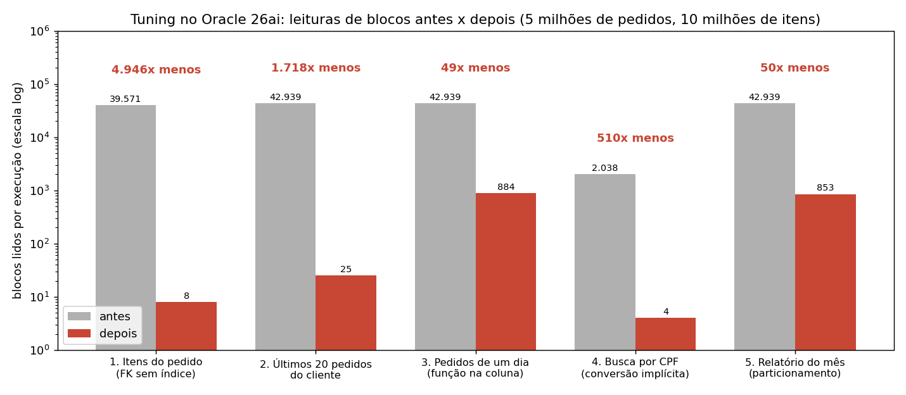

# Laboratório de DBA Oracle

> Atividades clássicas de um DBA Oracle feitas de ponta a ponta num ambiente que imita um servidor real: **Oracle AI Database 26ai Free** instalado por RPM num **Oracle Linux 10** (máquina virtual). Cada módulo traz os scripts, as evidências (logs) e o resultado medido.

| Módulo | Tema | Situação |
|---|---|---|
| [1. Tuning de desempenho](#módulo-1-tuning-de-desempenho) | Planos de execução, índices, reescrita de SQL e particionamento online | ✅ Concluído |
| 2. Backup e recuperação | ARCHIVELOG, RMAN, recuperação até um ponto no tempo, teste de desastre | Em breve |
| 3. Segurança e LGPD | Perfis de acesso, segurança por linha, mascaramento de dados pessoais, auditoria | Em breve |
| 4. Migração para a nuvem | Migração para o Oracle Autonomous Database (OCI) | Em breve |

---

## Ambiente

| Item | Configuração |
|---|---|
| Virtualização | VirtualBox no Windows; VM com 4 vCPUs, 6 GB de RAM e disco de 80 GB |
| Sistema operacional | Oracle Linux 10.2 (instalação "Server", sem interface gráfica) |
| Banco | Oracle AI Database 26ai Free 23.26.3, multitenant: CDB `FREE` e PDB `FREEPDB1` |
| Acesso | SSH (porta 2222) e listener (porta 1521) redirecionados do Windows para a VM |

**Instalação, como num servidor real:**

```bash
# pré-requisitos oficiais (usuário oracle, grupos, parâmetros de kernel, limites, pacotes)
dnf -y install oracle-ai-database-preinstall-26ai
# software do banco
dnf -y localinstall oracle-ai-database-free-26ai-23.26.3-1.el10.x86_64.rpm
# criação do banco (CDB + PDB) e do listener
/etc/init.d/oracle-free-26ai configure
# porta do listener e inicialização automática com o sistema
firewall-cmd --permanent --add-port=1521/tcp && firewall-cmd --reload
systemctl enable oracle-free-26ai
```

Antes dos módulos, os recursos disponíveis na edição Free foram conferidos em `V$OPTION`: Partitioning, Advanced Compression, Flashback Database, Fine-grained access control, Data Redaction e Unified Auditing estão ativos.

Um snapshot da VM com o banco recém-instalado permite voltar ao ponto inicial em segundos.

---

## Módulo 1: tuning de desempenho

**Cenário:** banco de um e-commerce com **200 mil clientes, 5 milhões de pedidos e 10 milhões de itens** (~800 MB), criado de propósito só com as chaves primárias e o índice único do CPF. Cinco consultas lentas típicas de produção foram diagnosticadas pelo plano de execução e corrigidas.



| # | Problema | Diagnóstico (plano de execução) | Correção | Blocos lidos (antes → depois) | Tempo (antes → depois) |
|---|---|---|---|---|---|
| 1 | Itens de um pedido | Chave estrangeira `itens_pedido.pedido_id` **sem índice**: leitura da tabela inteira (10 milhões de linhas) | Índice na chave estrangeira | 39.571 → **8** | 0,42 s → 0,01 s |
| 2 | Últimos 20 pedidos de um cliente | Leitura da tabela inteira + ordenação | Índice composto `(cliente_id, data_pedido)`: filtro e ordenação saem prontos do índice | 42.939 → **25** | 0,22 s → < 0,01 s |
| 3 | Pedidos de um dia | `TRUNC(data_pedido)` aplicado na coluna impede o uso de índice | Reescrever como intervalo de datas + índice local por data | 42.939 → **884** | 1,95 s → 0,02 s |
| 4 | Busca por CPF | CPF (texto) comparado com **número**: o Oracle converte a coluna (`TO_NUMBER`) e ignora o índice que já existia | Comparar com texto (correção na aplicação, sem criar nada) | 2.038 → **4** | 0,06 s → < 0,01 s |
| 5 | Relatório de um mês | Leitura dos 34 meses para usar 1 | **Particionamento online** por mês (`INTERVAL`): só a partição do mês é lida (*partition pruning*) | 42.939 → **853** | 0,31 s → 0,05 s |

*Medido com `SET AUTOTRACE TRACEONLY STATISTICS` e `SET TIMING ON`, na segunda execução de cada consulta. "Blocos lidos" são os consistent gets: a métrica principal, porque não depende do cache nem da máquina.*

**Destaques:**

- O particionamento foi feito com `ALTER TABLE ... MODIFY PARTITION BY RANGE ... ONLINE UPDATE INDEXES`: a tabela de 5 milhões de linhas virou 34 partições mensais **sem ficar indisponível** (1 min 13 s) e, com `INTERVAL`, cada novo mês ganha sua partição automaticamente.
- Os tempos absolutos são pequenos porque o banco inteiro cabe na memória da VM. Em produção, com centenas de sessões concorrentes e dados maiores que a memória, a redução de **50 a 5.000 vezes** nas leituras é o que evita filas de CPU e disco.
- Antes das correções, as consultas que varriam `PEDIDOS` faziam ~29 mil leituras físicas em toda execução: tabelas grandes lidas por inteiro usam *direct path read* e não ficam no cache.
- O cenário 1 também resolve um problema de concorrência: sem índice na chave estrangeira, apagar ou alterar um pedido trava a tabela de itens inteira.

**Como reproduzir** (dentro de `modulo-1-tuning`, na VM):

```bash
sqlplus / as sysdba @00_criar_usuario.sql                                # tablespace e usuário LAB
sqlplus lab/<senha>@//localhost:1521/FREEPDB1 @01_carga_dados.sql        # 15 milhões de linhas
sqlplus lab/<senha>@//localhost:1521/FREEPDB1 @02_consultas_antes.sql    # logs/antes.log
sqlplus lab/<senha>@//localhost:1521/FREEPDB1 @03_otimizacoes.sql        # logs/otimizacoes.log
sqlplus lab/<senha>@//localhost:1521/FREEPDB1 @04_consultas_depois.sql   # logs/depois.log
```

Os planos de execução completos de antes e depois estão em [`modulo-1-tuning/logs`](modulo-1-tuning/logs).

---

## Estrutura

```
laboratorio-dba-oracle/
├── modulo-1-tuning/
│   ├── 00_criar_usuario.sql      # tablespace LAB_DADOS e usuário LAB
│   ├── 01_carga_dados.sql        # modelo de e-commerce e carga de 15 milhões de linhas
│   ├── 02_consultas_antes.sql    # 5 cenários: plano + estatísticas
│   ├── 03_otimizacoes.sql        # índices e particionamento online
│   ├── 04_consultas_depois.sql   # mesmos cenários, otimizados
│   └── logs/                     # evidências: antes, otimizações e depois
└── docs/                         # imagens do README
```

## Tecnologias

Oracle AI Database 26ai Free · Oracle Linux 10 · SQL*Plus · PL/SQL · DBMS_XPLAN · DBMS_STATS · Partitioning · VirtualBox

## Autor

**Igor Bicalho**
[LinkedIn](https://www.linkedin.com/in/igorcbicalho)
